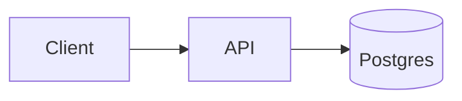
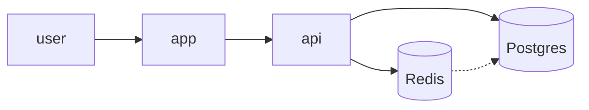
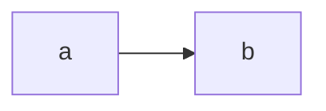

# Mermaid diagrams

Mermaid is the only diagram tool for decks in this stack. Do not use the addon's `Rough*` components in new slides. Every feature on this page has a working demo slide in `starter/demo.md` (section "Diagram & UI Components"). Copy from there before writing a diagram from scratch.

Versions: Slidev 53.1 bundles Mermaid 12.3. Syntax reference: https://mermaid.js.org/intro/ (check the version badge on each feature).

## How it works

Write a fenced block. The theme's `packages/slidev-theme-brand/setup/mermaid.ts` styles every diagram:

- `look: 'handDrawn'` — an Excalidraw-style sketch drawn with rough.js.
- Brand colors: navy fill, pink borders and edges, light text.
- The Geist font.

````md

````

Rules:

- **Never** add `style`, `classDef`, `%%{init}%%` theme variables or colors per diagram. Change `setup/mermaid.ts` if the brand needs a change.
- `{scale: …}` after `mermaid` is the only sizing knob. Start at `0.8`; tall diagrams (sequence, swimlane) usually need `0.4`–`0.5`.
- **Always check the slide in the browser.** Mermaid does not shrink to fit; an oversized diagram silently runs off the slide.
- Put per-diagram config in a frontmatter block at the top of the fence (see "Per-diagram config").

## Pick the diagram type

| The slide needs to show… | Use | Demo slide |
|---|---|---|
| How parts connect | `flowchart LR` / `TB` | Diagrams Are Just Code |
| A system built up click by click | `<MermaidSteps>` around a flowchart | Build the Diagram Click by Click |
| The order a request travels | `flowchart` + edge `step` | Number the Request Path |
| Who calls whom, over time | `sequenceDiagram` | Sequence Diagrams Show Who Calls Whom |
| Real-world parts (browser, terminal, DB) | flowchart node shapes | Shapes That Look Like Your Stack |
| A big system, then one part of it | collapsible subgraph | Zoom Out First, Then Zoom In |
| Who owns each step, handoffs | `swimlane-beta` | Who Owns Each Step? |
| A grammar or syntax rule | `railroad-ebnf-beta` | Grammar as a Picture |
| States and transitions | `stateDiagram-v2` | — |
| Data model | `erDiagram` / `classDiagram` | — |
| A timeline or roadmap | `timeline` / `gantt` | — |
| A share of a whole | `pie` (supports donut and a highlighted slice) | — |

## Features

### Step animation (Mermaid 12.3)

Name an edge with `id@-->`, then give it a `step`. A dot travels the edges in step order and loops. The playing edge is highlighted.

````md

````

- Edges that share a step number play together.
- The loop is not tied to Slidev clicks. Talk over it; don't wait for it.
- Turn on `stepNumbers` whenever the deck is exported, because exports are static.

### Click-by-click reveal: `<MermaidSteps>` (addon)

Wrap a flowchart to reveal it one step per click. Mermaid lays the diagram out once, so nothing jumps.

````md
<MermaidSteps :steps="['user', 'app', 'api', 'db cache', 'e5']">



</MermaidSteps>
````

- `steps`: one entry per click. An entry lists node ids (and named edge ids) separated by spaces. Step 0 is visible before the first click.
- Unnamed edges appear automatically once both ends are visible. Named edges (`e5@-->`) must be listed; the SVG doesn't record their ends.
- Unlisted nodes appear at the last step.
- `hidden="dim"` shows future steps at 15% opacity instead of hiding them.
- `at` works like `v-click`'s `at`, to combine with other clicks on the slide.
- No `clicks:` frontmatter: the component registers its own clicks.
- A wrong id renders a red error listing the real ids.
- Exports show the full diagram.
- Demo slide: "Build the Diagram Click by Click" (`routeAlias: mermaid-steps`). Tests: `agent_docs/testing.md`.

### Node shapes (Mermaid 11.17)

`id@{ shape: <name>, label: "…" }`. Shapes that read well on dev slides: `person`, `browser`, `console` (a terminal window), `datastore`, `bucket`, `folder`, `cyl` (database). Classic syntax still works: `[box]`, `([pill])`, `[(database)]`, `{diamond}`.

### Collapsible subgraphs (Mermaid 11.17)

`group@{ view: collapsed }` draws a whole subgraph as one node; edges into it are redirected to that node. For a "zoom in" moment, put the collapsed and expanded versions on two consecutive slides, or stack both on one slide.

### Sequence diagrams

`autonumber` numbers every message so you can say "at step 4…". Use `actor` for people, `participant X as Label` for systems, `alt` / `else` / `end` for branches, `-->>` for replies.

### Swimlanes (beta, Mermaid 11.16)

`swimlane-beta LR` plus one `subgraph` per lane. Beta: the syntax may still change. Lanes stack vertically and get tall fast, so start at `{scale: 0.42}`.

### Railroad diagrams (beta, Mermaid 11.16)

`railroad-ebnf-beta`, then one EBNF rule per line ending in `;`. Also `railroad-abnf-beta`, `railroad-peg-beta`.

## Per-diagram config

A YAML block at the top of the fence overrides the theme for that one diagram:

````md

````

Use `look: classic` when the audience must read exact details: dense architecture, many labels, or a diagram that is also printed.

## Limits

- **Not every type sketches.** In-browser check on Mermaid 12.3: flowcharts (all shapes, subgraphs, step animation) are hand-drawn. `sequenceDiagram`, `swimlane-beta` and `railroad-*` render clean even with `look: handDrawn`. For any other type, look before promising a sketch.
- **Click-by-click reveal works for flowcharts only** (via `<MermaidSteps>`). `v-click` can't target single nodes because Slidev renders the diagram as one SVG. For other diagram types, build up across consecutive slides.
- **Exports are static.** PDF and PPTX show one frame, and `pptx-editable` embeds the diagram as an image. Turn on `stepNumbers` so the order still reads.
- **Beta types** (`swimlane-beta`, `railroad-*-beta`, `treeView-beta`, `architecture-beta`) may break on a Mermaid upgrade. Re-check those slides after `pnpm update`.
