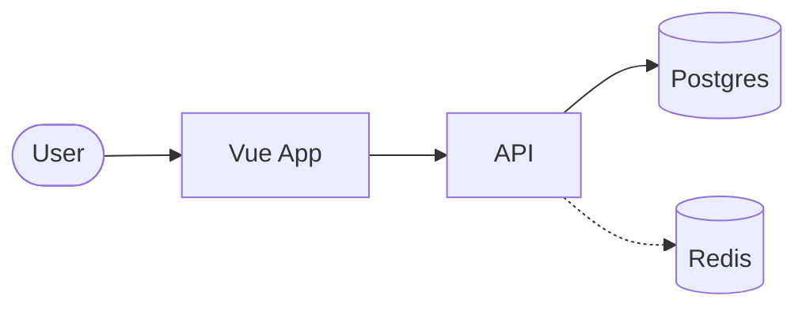
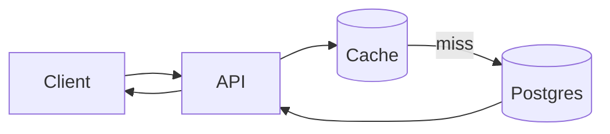
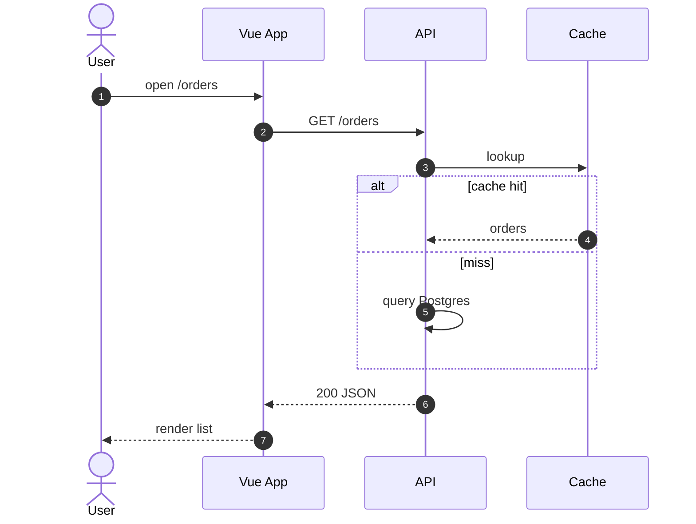
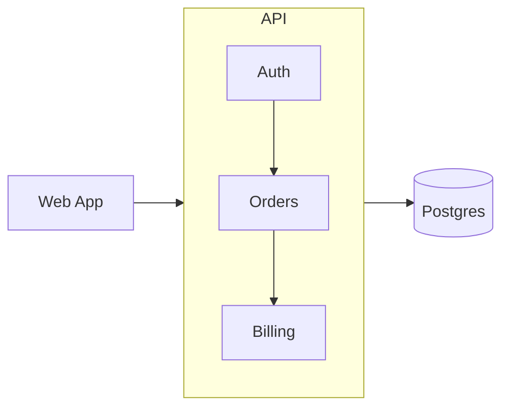
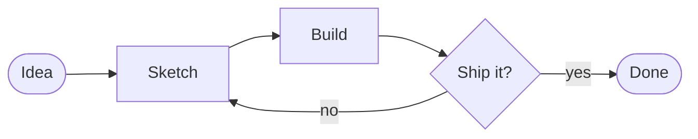

# Example Talk

By Alexander Opalic

<!--
Welcome everyone! This presentation demonstrates the full capabilities of the @alexop/slidev-theme-brand theme and @alexop/slidev-addon-utils addon.
-->

---
layout: section
---

# Agenda

<v-clicks>

1. About me
2. Why Slidev?
3. Layouts & Components
4. How It Works
5. Live Demo
6. Key Features

</v-clicks>

---

# About me

<About />

<!--
Quick intro — the About component from the addon handles the layout automatically with avatar and bio list.
-->

---

# Why?

Slidev makes creating presentations:

<v-clicks>

- **Developer-friendly** — Write slides in Markdown
- **Themeable** — Customize with Vue components
- **Interactive** — Add live coding demos
- **Exportable** — PDF, PNG, or SPA

</v-clicks>

---
layout: TwoCols
---

::left::

## Main Content

This is your main content on the left side.

You can include:
- Lists
- Code blocks
- Images

::right::

<Callout type="info">

### Pro Tip

Use the TwoCols layout for side-by-side content comparisons or to highlight important information!

</Callout>

---

# How It Works

<v-clicks>

1. **Write** — Edit `slides.md` with your content
2. **Preview** — Run `pnpm dev` to see live changes
3. **Style** — Customize theme and components
4. **Export** — Generate PDF or PNG outputs

</v-clicks>

<Callout type="warn">
Remember to install dependencies first with `pnpm install`
</Callout>

---
layout: section
---

# Demo Time

---

# Code Example

Here's a simple Vue component:

```vue {1|3-4|6-10|all}
<script setup>
import { ref } from 'vue'

const count = ref(0)
</script>

<template>
  <button @click="count++">
    Count: {{ count }}
  </button>
</template>
```

<!--
Click through to highlight: imports, reactive state, then the template with the click handler.
-->

---

<VuePlayground
  height="450px"
  url="https://play.vuejs.org/#eNp9kUFLwzAUx7/KM5cqzBXR0+gGKgP1oKKCl1xG99ZlpklIXuag9Lv7krK5w9it7//7v/SXthP3zo23EcVEVKH2yhEEpOhm0qjWWU/QgccV9LDytoWCq4U00tTWBII2NDBN/LJ4Qq0tfFuvlxfFlTRVORzHB/FA2Dq9IOQJoFrfzLouL/d9VfKUU2VcJNhet3aJeioFcymgZFiVR/tiJCjw61eqGW+CNWzepX0pats6pdG/OVKsJ8UEMklswXa/LzkjH3G0z+s11j8n8k3YpUyKd48B/RalODBa+AZpwPPPV9zx8wGyfdTcPgM/MFgdk+NQe4hmydpHvWz7nL+/Ms1XmO8ITdhfKommZp/7UvA/eTxz9X/d2/Fd3pOmF/0fEx+nNQ=="
/>

<!--
This is the VuePlayground component from the addon — it embeds the Vue SFC Playground directly in your slides.
-->

---

# Key Features

<div class="grid grid-cols-2 gap-6 mt-4">
<v-clicks>

<div class="p-5 rounded-lg border border-white/10 bg-white/5">
  <div class="text-3xl mb-2">🔥</div>
  <h3 class="text-lg font-bold mb-1">Hot Reload</h3>
  <p class="text-sm op-70">Instant preview as you edit your slides in Markdown</p>
</div>

<div class="p-5 rounded-lg border border-white/10 bg-white/5">
  <div class="text-3xl mb-2">🎨</div>
  <h3 class="text-lg font-bold mb-1">Themeable</h3>
  <p class="text-sm op-70">Custom themes with Vue components and UnoCSS</p>
</div>

<div class="p-5 rounded-lg border border-white/10 bg-white/5">
  <div class="text-3xl mb-2">📦</div>
  <h3 class="text-lg font-bold mb-1">Exportable</h3>
  <p class="text-sm op-70">Export to PDF, PNG, or deploy as a static SPA</p>
</div>

<div class="p-5 rounded-lg border border-white/10 bg-white/5">
  <div class="text-3xl mb-2">🧩</div>
  <h3 class="text-lg font-bold mb-1">Extensible</h3>
  <p class="text-sm op-70">Addons, components, and layouts for reusable content</p>
</div>

</v-clicks>
</div>

---
clicks: 9
---

# FolderTree Component

Interactive file explorer with click-based folder reveal.

<FolderTree
  root
  title="Flat Structure"
  :structure="`src/
  components/
    BaseButton.vue
    BaseCard.vue
    BaseInput.vue
    TodoList.vue
    TodoListItem.vue
    TheHeader.vue
  composables/
    useTodos.ts
    useLocalStorage.ts
    useKeyboard.ts
  utils/
    validators.ts
    dateHelpers.ts
    todoHelpers.ts
  plugins/
    api.ts
    auth.ts
    toast.ts
    i18n.ts
  layout/
    DefaultLayout.vue
    AdminLayout.vue
  views/
    Home.vue
    TodosPage.vue
    CompletedPage.vue
  router/
    index.ts
  store/
    useTodosStore.ts
  assets/
App.vue
main.js`"
  :open-on-clicks="[
    '/src',
    '/src/components',
    '/src/composables',
    '/src/utils',
    '/src/plugins',
    '/src/layout',
    '/src/views',
    '/src/router',
    '/src/store',
  ]"
/>

<!--
Each click reveals a different folder. Use openOnClicks with an array of paths to walk through a project structure step by step.
The clicks frontmatter should match the number of openOnClicks entries.
-->

---
layout: code-editor
project: my-vue-app
activeFile: schema.ts
tabs: schema.ts, App.vue
files: |
  src
    schema.ts
    components/
      ChatApp.vue
    utils/
      helpers.ts
  package.json
  tsconfig.json
---

```ts
import { z } from 'zod'

export const userSchema = z.object({
  id: z.string().uuid(),
  name: z.string().min(1),
  email: z.string().email(),
  role: z.enum(['admin', 'user', 'guest']),
})

export type User = z.infer<typeof userSchema>
```

<!--
The code-editor layout provides a VS Code-style window with title bar, file tree sidebar, and tabbed code area. Pass files as an indentation-based string and set the active tab.
-->

---
layout: code-editor
project: my-vue-app
activeFile: useCounter.ts
tabs: useCounter.ts
files: |
  src
    composables/
      useCounter.ts
  package.json
---

```ts {all|1|3-5|7-10}
import { ref, computed } from 'vue'

export function useCounter(initial = 0) {
  const count = ref(initial)
  const double = computed(() => count.value * 2)

  function increment() {
    count.value++
  }

  return { count, double, increment }
}
```

<!--
Click-driven code walkthrough: `{all|1|3-5|7-10}` highlights one region per click with a pink accent band — everything else dims, like stepping through code in a review.

[click] The import line.
[click] Reactive state.
[click] The increment action.
-->

---
layout: code-editor
project: my-vue-app
activeFile: schema.ts
tabs: schema.ts, api.ts@1, App.vue@2
files: |
  src
    schema.ts
    api.ts
    App.vue
  package.json
---

````md magic-move
```ts
// schema.ts
import { z } from 'zod'

export const userSchema = z.object({
  id: z.string().uuid(),
  name: z.string().min(1),
})

export type User = z.infer<typeof userSchema>
```

```ts
// api.ts
import { userSchema, type User } from './schema'

export async function fetchUser(id: string): Promise<User> {
  const res = await fetch(`/api/users/${id}`)
  return userSchema.parse(await res.json())
}
```

```vue
<!-- App.vue -->
<script setup lang="ts">
import { fetchUser } from './api'

const user = await fetchUser('42')
</script>

<template>
  <h1>Hello {{ user.name }}</h1>
</template>
```
````

<!--
An editing session across files: Magic Move morphs the code on each click, and the `@N` suffix on tabs (`api.ts@1, App.vue@2`) switches the active tab and file-tree highlight in sync — it reads like really jumping between files in VS Code.

[click] Switch to api.ts — consume the schema.
[click] Switch to App.vue — use it in a component.
-->

---
layout: code-editor
project: my-vue-app
activeFile: user.ts
tabs: user.ts
files: |
  src
    user.ts
  package.json
---

```ts {*} twoslash
interface User {
  id: string
  name: string
  role: 'admin' | 'editor' | 'viewer'
}

function greet(user: User) {
  return `Hello ${user.name}!`
}

const alex: User = { id: '1', name: 'Alex', role: 'admin' }

const message = greet(alex)
//    ^?
```

<!--
TwoSlash gives real VS Code hovers: move the mouse over any identifier during the talk and the actual TypeScript type pops up. The `^?` query pins the type of `message` permanently. Syntax: ```ts {*} twoslash — the {*} is required (Slidev drops the twoslash flag without it).
-->

---
layout: section
---

# Diagram & UI Components

---

# Diagrams Are Just Code

A fenced ` ```mermaid ` block. The theme makes it hand-drawn and on brand — no styling per diagram.



<!--
**Mermaid is the only diagram tool in this stack.** The theme's `setup/mermaid.ts` sets brand colors, Geist, and the hand-drawn look for every diagram.

- `e1@{ step: 1 }` (Mermaid 12.3): a dot travels the edges in step order and loops.
- Mermaid 12 lays out with **ELK** by default. Add `config: { layout: dagre }` inside the block for the older layout.
- Never hard-code `style` or `classDef` colors per diagram.
- Full reference: `agent_docs/mermaid.md`.
-->

---

# Number the Request Path

`stepNumbers` badges every step, `stepDuration` sets the pace (Mermaid 12.3).



<!--
The badges make the order readable even in the PDF export, where nothing animates. The dot loops on its own, so talk over it instead of waiting for it.
-->

---

# Sequence Diagrams Show Who Calls Whom

`sequenceDiagram` — participants, messages, `alt` branches, and `autonumber`.



<!--
Use a sequence diagram when time order matters more than structure: auth flows, retries, cache behavior. `autonumber` lets you say "at step 4…" while pointing.
-->

---

# Shapes That Look Like Your Stack

`A@{ shape: browser }` — plus `person`, `console`, `datastore`, `bucket`, `folder`.

```mermaid {scale: 0.85}
flowchart LR
  dev@{ shape: person, label: "Developer" }
  term@{ shape: console, label: "pnpm dev" }
  app@{ shape: browser, label: "localhost:3030" }
  repo@{ shape: folder, label: "src/" }
  db@{ shape: datastore, label: "Postgres" }
  s3@{ shape: bucket, label: "Assets" }
  dev --> term --> app
  term --> repo
  app --> db
  app --> s3
```

<!--
New in Mermaid 11.17. Architecture slides read faster when a browser looks like a browser instead of a box labelled "Browser".
-->

---

# Zoom Out First, Then Zoom In

`api@{ view: collapsed }` hides a subsystem behind one node. Remove it to expand.

<div class="flex flex-col gap-6 mt-6">
<div>



</div>
<div>


</div>
</div>

<!--
In a real talk, put these on two consecutive slides: show the big picture, then click into the one box you want to explain. Edges into the group automatically land on the collapsed node.
-->

---
routeAlias: mermaid-steps
---

# Build the Diagram Click by Click

`<MermaidSteps>` reveals one step per click. Edges appear once both ends are visible.

<MermaidSteps :steps="['user', 'app', 'api', 'db cache', 'e5']" class="mt-8">

```mermaid {scale: 0.75}
flowchart LR
  user@{ shape: person, label: "User" } --> app@{ shape: browser, label: "Vue App" }
  app --> api[API]
  api --> db[(Postgres)]
  api --> cache[(Redis)]
  cache e5@-.->|warm| db
```

</MermaidSteps>

<!--
Step 0 shows only the user. Each click adds the next entry.

[click] The app — the arrow from the user appears with it.
[click] The API.
[click] Postgres and Redis together: one step can list several ids.
[click] The named edge `e5` gets its own click; named edges must be listed.
-->

---

# Who Owns Each Step?

`swimlane-beta` gives every actor a lane, so handoffs are visible.

```mermaid {scale: 0.42}
swimlane-beta LR
  subgraph Developer
    push[Push branch]
    fix[Fix review notes]
  end
  subgraph CI
    test[Run tests]
    preview[Deploy preview]
  end
  subgraph Reviewer
    review[Review PR]
    merge[Merge]
  end
  push --> test --> preview --> review
  review -->|changes| fix --> test
  review -->|approve| merge
```

<!--
Swimlanes are beta since Mermaid 11.16; the syntax may still change. Use them when the question is "who does what", not only "what happens next".
-->

---

# Classic When It Must Be Precise

Hand-drawn is the default. Opt one diagram out with `look: classic`.



<!--
The hand-drawn look signals "this is a sketch of the idea". Switch to classic when the audience must read exact details: dense architecture, many labels, or a diagram you also print.
-->

---

# Grammar as a Picture

`railroad-ebnf-beta` turns an EBNF rule into a syntax diagram.

```mermaid {scale: 0.9}
railroad-ebnf-beta
semver = number "." number "." number [ "-" tag ] ;
number = digit { digit } ;
tag = ident { "." ident } ;
```

<!--
Railroad diagrams (beta, Mermaid 11.16) beat a regex on a slide. Also accepts ABNF and PEG via railroad-abnf-beta and railroad-peg-beta.
-->

---
clicks: 2
---

# TerminalWindow

<TerminalWindow
  title="~/my-vue-app"
  stepped
  :lines="[
    { cmd: 'pnpm create vue@latest', output: '✔ Scaffolding project in ./my-vue-app' },
    { cmd: 'pnpm install', output: 'Done in 4.2s' },
    { cmd: 'pnpm dev', output: 'VITE v6.0.0  ready in 320 ms\n➜  Local: http://localhost:5173/' },
  ]"
/>

<!--
Each click reveals the next command + output. Without the lines prop it renders the default slot, so you can also paste arbitrary content into the frame.
-->

---

# Terminal Recordings (VHS)

Scripted clips rendered from `recordings/*.tape` — deterministic, re-renderable, no live-demo risk.

<SlidevVideo autoplay muted loop controls class="h-90 mx-auto mt-2 rounded-lg overflow-hidden">
  <source src="/recordings/claude-code-template.webm" type="video/webm" />
</SlidevVideo>

<!--
This clip is fake: a VHS tape types the prompt while a shell shim paints the Claude Code banner and streams scripted turns. Copy a template pair from starter/recordings (Claude Code or Copilot CLI), script your turns, then `vhs <name>.tape` — the webm lands in public/recordings/. See agent_docs/terminal-recordings.md.
-->

---

# BrowserWindow

<BrowserWindow src="https://alexop.dev" height="360px" />

<!--
Pass src for a live iframe, or drop a screenshot / any content into the default slot. The url prop overrides what the address bar shows.
-->

---

# Annotate Anything

Hand-drawn callouts over any content — position inside a `relative` container, reveal with `v-click`.

<div class="relative w-fit mx-auto mt-4">

```ts
export function useCounter() {
  const count = ref(0)
  const double = computed(() => count.value * 2)
  return { count, double }
}
```

<Annotate v-click type="circle" :x="108" :y="10" :width="76" :height="32" label="reactive state" label-position="right" />
<Annotate v-click type="underline" :x="113" :y="29" :width="225" :height="24" label="derived" label-position="right" variant="success" />

</div>

<!--
Types: circle, rect, underline, arrow. Great for pointing at parts of screenshots or code during a talk.
-->

---
clicks: 3
---

# Steps

Talk roadmap or process indicator, driven by clicks.

<Steps class="mt-14" :steps="['Problem', 'Idea', 'Build', 'Ship']" />

<!--
Each click advances the active step. Pass the active prop instead for a static indicator.
-->

---

# Comparison

<Comparison left-title="❌ Options API" right-title="✅ Composition API">

<template #left>

- Logic scattered across options
- Hard to extract & reuse
- `this` everywhere

</template>

<template #right>

- Logic grouped by feature
- Composables are just functions
- Full TypeScript support

</template>

</Comparison>

<!--
Titles and variants are configurable — leftVariant / rightVariant accept `default`, `accent`, `success`, `danger` and `muted`.
-->

---

# Presenter Notes

Open `/presenter` in a second tab and click through this slide.

<v-clicks>

- **Notes are Markdown** — bold the word you must not forget
- **`[click]` markers** highlight the line for the current click
- **`[click:2]`** skips a click that needs no note
- **Long notes auto-scroll**, in dev and in built decks

</v-clicks>

<div v-click class="mt-6 opacity-70">Timer: <code>duration: 30min</code> + <code>timer: countdown</code> in the headmatter.</div>

<!--
**Goal:** the audience learns the notes workflow in one slide.

- Notes render as Markdown, so write scan-able beats, not a script
- The notes panel is now resizable past 720px — drag it wide on a big monitor

[click] **Markdown** — keep one beat per line, bold the keyword.

[click] **Markers** — the current beat lights up, past beats fade.

[click:2] **Skip** — this beat lands on click 4. Click 3 had no note: the bullet on screen says it all. Double-click a marker to jump the slide to that click.

[click] **Timer** — countdown turns the progress bar into a pacing check. Say: "Questions at the end."
-->

---
layout: section
---

# Questions?

---
layout: end
---

# Thank You!

Find the source at [github.com/alexanderopalic](https://github.com/alexanderopalic)

<!--
Thanks for watching! This presentation was built with the @alexop/slidev-theme-brand theme and @alexop/slidev-addon-utils addon.
-->
