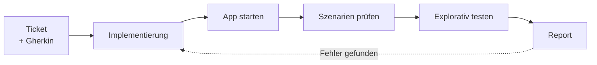

# Vom Ticket zum <span class="text-[#ff6bed]">Beweis</span>

Agents, die ihre Arbeit selbst prüfen

<div class="mt-8 text-lg opacity-70">Alexander Opalic · QS-Tag Frankfurt 2026</div>

<!--
TIME: 0:00–0:45 (45s)

- Kurz Hallo sagen.
- **Hook:** „Der letzte Talk des Tages. Also bewegen wir uns erst mal.“
- Keine Notizen nötig, die Slides teile ich am Ende per QR-Code.
-->

---

<About />

<!--
TIME: 0:45–1:00 (15s)

- Name, Entwickler aus Deutschland, alexop.dev.
- **Ehrlich sagen:** Ich bin Entwickler, kein QA-Engineer. Ich zeige euch meinen Blick von der Entwicklerseite.
-->

---
layout: statement
---

# 🙋 Alle <span class="text-[#ff6bed]">aufstehen</span>, bitte

<div class="mt-8 text-2xl opacity-80 space-y-3">
  <div v-click>Stehen bleiben: Ihr nutzt KI im Alltag.</div>
  <div v-click>Hinsetzen: Ihr schreibt alle Tests noch von Hand.</div>
  <div v-click class="text-[#ff6bed]">Wer noch steht: Ihr habt automatische Verifikationsschleifen.</div>
</div>

<!--
TIME: 1:00–2:15 (75s)

- [Ask for hands] Erst sollen **alle** aufstehen.
- [click] Wer KI im Alltag nutzt, bleibt stehen. Die anderen setzen sich.
- [click] Wer alle Tests noch von Hand schreibt, setzt sich.
- [click] Wer jetzt noch steht, hat automatische Verifikationsschleifen. **Applaus** für die!
- Danach alle hinsetzen lassen. „Für alle, die jetzt sitzen: Genau darum geht's in den nächsten 30 Minuten.“
-->

---
layout: statement
---

# Robert hat gezeigt, wo der <span class="text-[#ff6bed]">Determinismus</span> anfängt.

<div class="mt-8 text-2xl opacity-80">Ich zeige euch, was der Agent <b>davor</b> schon leisten kann.</div>

<!--
TIME: 2:15–2:45 (30s)

- Brücke zum Talk von **Robert Fey** direkt vor mir.
- Er hat gezeigt, wo der Determinismus anfängt. Ich gehe einen Schritt davor: Was kann ein Agent prüfen, bevor überhaupt ein deterministischer Test existiert?
- STREICHKANDIDAT, wenn die Zeit knapp wird.
-->

---

# So haben wir Software <span class="text-[#ff6bed]">ohne KI</span> gebaut

<DeliveryFactory era="2022" />

<!--
TIME: 2:45–3:45 (60s)

- Das ist meine **Delivery Factory** von alexop.dev/lab, gebaut wie eine Fabrik in Factorio. Jede Maschine ist eine Station im Team.
- Gelbes Band: **Business** macht aus Ideen Tickets. Rotes Band: **Dev** macht daraus PRs. Blaues Band: **Code Review**.
- **QA & Testing** prüft jeden PR von Hand. Jeder vierte wird ein Bug, und der Splitter schickt ihn zurück zu Dev.
- **Release** shippt den Rest. 2022 staut es sich **vor Dev**: Code schreiben war der teure Schritt.
- Testen war damals Klickarbeit am Ende des Bands, wenn alles andere schon fertig war.
- SOURCE: alexop.dev/lab/delivery-factory, Blogpost „The Factory Must Grow: AI moved the bottleneck“
-->

---

# Mit KI wandert der <span class="text-[#ff6bed]">Engpass</span>

<DeliveryFactory era="2026" />

<!--
TIME: 3:45–4:45 (60s)

- Gleiche Fabrik, Jahr 2026. Die blauen **Beacons** an Dev sind die Coding-Agents.
- Dev ist jetzt schnell. Das rote Band läuft voll mit PRs.
- Der Stau wandert zu **Code Review** und **QA**. „Shipped / day“ bewegt sich kaum, egal wie viele Beacons ich baue.
- Ich merge mehr PRs als je zuvor und lese immer weniger davon Zeile für Zeile.
- Wer live spielen will: alexop.dev/lab/delivery-factory, da gibt's auch die Research-Upgrades.
-->

---
layout: statement
---

# Coding ist weitgehend <span class="text-[#ff6bed]">gelöst</span>.

<div class="mt-8 text-2xl opacity-80">Wer PRs mergen will, ohne jede Zeile zu lesen,<br/>braucht bessere <span class="text-[#ff6bed]">automatische Verifikation</span>.</div>

<!--
TIME: 4:45–5:45 (60s)

- **Die Kernthese** des Talks.
- „Weitgehend“ ist bewusst gewählt. Es gibt noch harte Probleme. Aber für einen typischen Frontend-Ticket schreibt der Agent den Code.
- Die Frage ist also nicht mehr „Wer schreibt das?“, sondern „Woher weiß ich, dass es stimmt?“
-->

---
layout: image-right
image: /pr-136.png
backgroundSize: contain
---

# Das <span class="text-[#ff6bed]">Zielbild</span>

Ein PR, der seinen Beweis gleich mitbringt.

<v-clicks>

- 📸 Screenshots
- 🎬 Ein Video vom Durchlauf
- ⚖️ Ein Urteil: Ist das Ticket erfüllt?

</v-clicks>

<!--
TIME: 5:45–6:45 (60s)

- So soll ein PR aussehen: nicht nur Code, sondern **Belege**.
- [click] Screenshots von jedem geprüften Szenario.
- [click] Ein Video, damit ich sehe, was der Agent gemacht hat.
- [click] Ein klares Urteil. Dann muss ich nicht raten.
- Rechts ein echter PR aus meinem Workout-Projekt, mit Szenarien in der Beschreibung.
-->

---

# Claude Code ist mehr als ein <span class="text-[#ff6bed]">Chatbot</span>

<div class="flex justify-center mt-6">

```mermaid {scale: 0.75}
flowchart LR
  you@{ shape: person, label: "Du" } --> cc@{ shape: console, label: "Claude Code" }
  cc --> tools[Tools<br/>Bash, Read, Edit, Browser]
  cc --> hooks[Hooks<br/>laufen bei jedem Schritt]
  cc --> skills[Skills<br/>Wissen auf Abruf]
```

</div>

<div v-click class="mt-8 text-center text-xl opacity-80"><b>LLM denkt, Tools handeln, die Schleife wiederholt.</b></div>

<!--
TIME: 6:45–7:45 (60s)

- Claude Code in einem Bild. Ein Agent, der im Terminal läuft.
- **Tools:** lesen, schreiben, Bash ausführen. Damit kann er auch einen Browser steuern.
- **Hooks:** Code, der automatisch bei bestimmten Schritten läuft. Zum Beispiel nach jedem Edit den Linter.
- **Skills:** Markdown-Dateien mit Wissen, die der Agent nur lädt, wenn er sie braucht.
- [click] Mehr ist ein Agent nicht.
-->

---

# Die <span class="text-[#ff6bed]">Augen und Hände</span> des Agenten

<div class="grid grid-cols-2 gap-5 mt-8 text-base">
  <div v-click class="border border-white/20 rounded px-4 py-3 bg-white/5">
    <div class="font-bold text-lg">Playwright CLI</div>
    <div class="opacity-80">Für Teams, die Playwright schon kennen. Stabil und günstig.</div>
  </div>
  <div v-click class="border border-white/20 rounded px-4 py-3 bg-white/5">
    <div class="font-bold text-lg">Playwright MCP</div>
    <div class="opacity-80">Zum lokalen Erkunden. Bequem, aber teuer im Kontext.</div>
  </div>
  <div v-click class="border border-[#ff6bed] rounded px-4 py-3 bg-[#ff6bed]/10">
    <div class="font-bold text-lg">Agent Browser</div>
    <div class="opacity-80">Mein Favorit. Snapshot mit Refs, gebaut für Agents.</div>
  </div>
  <div v-click class="border border-white/20 rounded px-4 py-3 bg-white/5">
    <div class="font-bold text-lg">Computer Use</div>
    <div class="opacity-80">Wenn es keinen Browser gibt: Desktop-Apps, Legacy-UIs.</div>
  </div>
</div>

<!--
TIME: 7:45–8:45 (60s)

- Ohne Browser ist der Agent blind. Also geben wir ihm Augen und Hände.
- [click] **Playwright CLI:** Kennt ihr schon. Der Agent ruft es über Bash auf.
- [click] **Playwright MCP:** Gut, um lokal zu erkunden. Schiebt aber bei jedem Schritt viel in den Kontext.
- [click] **Agent Browser** von Vercel Labs: Rust-CLI, Accessibility-Snapshot mit Refs wie @e1. Das nutze ich.
- [click] **Computer Use:** Der Agent sieht den Bildschirm und klickt per Maus. Langsam, aber geht überall.
-->

---

# CLI schlägt MCP, sobald es <span class="text-[#ff6bed]">ernst</span> wird

<div class="grid grid-cols-2 gap-10 mt-12 items-end">
  <div class="text-center">
    <div class="text-7xl font-bold opacity-60">114k</div>
    <div class="mt-3 text-xl opacity-80">Tokens pro Test mit <b>MCP</b></div>
  </div>
  <div class="text-center">
    <div class="text-7xl font-bold text-[#ff6bed]">27k</div>
    <div class="mt-3 text-xl opacity-80">Tokens pro Test mit der <b>CLI</b></div>
  </div>
</div>

<div v-click class="mt-12 text-center text-xl opacity-80">MCP zum Erkunden. CLI für alles, was jeden Tag läuft.</div>

<!--
TIME: 8:45–9:30 (45s)

- Gleicher Smoketest, zwei Werkzeuge.
- MCP schiebt jeden Snapshot direkt in den Kontext. Die CLI schreibt auf die Platte, und der Agent liest nur, was er braucht.
- Etwa **4-mal weniger** Tokens. Das heißt günstiger und stabiler, weil der Kontext nicht vollläuft.
- [click] Meine Regel: MCP lokal zum Erkunden, CLI in der Pipeline.
- SOURCE: „Playwright CLI vs MCP: A New Tool for Your Coding Agent“ (114k vs 26,8k), siehe Quality-Night-Deck.
- STREICHKANDIDAT, wenn die Zeit knapp wird.
-->

---

# Das <span class="text-[#ff6bed]">Gedächtnis</span> des Agenten

<div class="grid grid-cols-[1fr_1.1fr] gap-8 mt-4 items-start">
<div>

```text
.claude/skills/verify-otto-shop/
├── SKILL.md
├── scripts/
│   └── otto-verify.sh
└── features/
    ├── README.md
    ├── startseite.md
    ├── suche.md
    ├── kategorie-listing.md
    ├── produktseite.md
    ├── warenkorb.md
    └── merkzettel.md
```

</div>
<div>

<v-clicks>

- **SKILL.md:** App starten, prüfen, bedienen, aufräumen
- **features/:** eine Datei pro Feature, auf Deutsch
- Jede Datei sagt: Wie komme ich hin? Wie bediene ich es? Woran sehe ich, dass es klappt?

</v-clicks>

<div v-click class="mt-6 text-lg">Der Agent muss nicht raten, was es gibt. Er <span class="text-[#ff6bed]">schlägt nach</span>.</div>

</div>
</div>

<!--
TIME: 9:30–10:30 (60s)

- Ein Agent startet jede Session ohne Erinnerung. Er kennt euren Shop nicht.
- Das hier ist echt: Ich habe `/create-verification-skill` aus pstack im Otto-Klon laufen lassen.
- [click] Die SKILL.md erklärt Launch, Doctor, Drive, Evidence, Cleanup.
- [click] Die **Feature Map**: sechs Dateien, eine pro Feature.
- [click] Jede Datei hat dieselben vier Abschnitte: Unterfeatures, Einstiege aus Nutzersicht, Rezept mit echten Befehlen, Gotchas.
- [click] Das ist im Grunde ein Testkonzept, das der Agent lesen kann.
- SOURCE: otto-nuxt-shop, Commit 01f006e, `.claude/skills/verify-otto-shop/`
-->

---

# So hilft der Skill bei <span class="text-[#ff6bed]">jedem Lauf</span>

<div class="grid grid-cols-[1fr_1.2fr] gap-8 mt-6 items-start">
<div>

<v-clicks>

1. **Launch:** startet den Shop auf einem freien Port
2. **Doctor:** prüft, ob die Instanz taugt
3. **Drive:** bedient die App wie ein Mensch
4. **Evidence:** Screenshot, Snapshot, Cookies pro Schritt
5. **Cleanup:** räumt auf, Belege bleiben

</v-clicks>

</div>
<div v-click>

```text
$ otto-verify.sh doctor
ok   port 3100 owned by our run
ok   GET / renders OTTO homepage (SSR)
ok   /api/products total=184
ok   internet reachable
```

<div class="mt-4 text-lg opacity-80">Jeder Agent startet <b>gleich</b>. Nicht jeder erfindet seinen eigenen Weg.</div>

</div>
</div>

<!--
TIME: 10:30–11:30 (60s)

- Der Skill ist ein Rezept, das jeder Agent gleich abarbeitet.
- [click] Launch: startet den Shop. Bei mir auf Port 3100, weil 3000 belegt war. Das hat der Agent selbst gemerkt und eingebaut.
- [click] Doctor: Läuft die richtige Instanz? Sind die Daten da?
- [click] Drive: echte Klicks über agent-browser, mit ARIA-Rollen statt fragiler Selektoren.
- [click] Evidence: Vorher-Nachher-Belege pro Schritt.
- [click] Cleanup: Er stoppt nur, was er selbst gestartet hat.
- [click] Das ist echter Output. Ohne den Skill würde jeder Agent-Lauf anders anfangen.
-->

---
layout: statement
---

# Beim Erstellen hat der Agent schon einen <span class="text-[#ff6bed]">echten Bug</span> gefunden.

<div class="mt-8 text-2xl opacity-80">Pfeil nach unten in der Suche markiert keinen Vorschlag.</div>

<div class="mt-6 text-lg opacity-60">9 Minuten · 56 Schritte · 3,37 $</div>

<!--
TIME: 11:30–12:15 (45s)

- Den Bug habe ich nicht eingebaut. Den hat der Agent beim Erkunden des Shops gefunden.
- In der Suche springt ArrowDown immer wieder auf -1. Enter landet dann auf der Ergebnisseite statt beim Produkt.
- Er hat ihn nicht gefixt, sondern in `suche.md` als erwarteten Fehler dokumentiert.
- Kosten für den ganzen Skill: unter 4 Dollar.
- SOURCE: otto-nuxt-shop `app/components/SearchBox.vue:39`, Log `.talk-logs/01-create-verification-skill.jsonl`
-->

---
layout: image
image: /otto-klon.png
backgroundSize: contain
---

<h1 class="sr-only">Unser Beispiel: ein Otto-Klon in Nuxt</h1>

<!--
TIME: 12:15–12:45 (30s)

- Das ist unser laufendes Beispiel: ein Otto-Klon in Nuxt 4 mit dem offenen B2B-Designsystem von OTTO.
- Startseite, Suche, Kategorien, Produktseite, Warenkorb, Merkzettel.
- Inoffizielle Demo, nicht von OTTO.
- Repo: github.com/alexanderop/otto-nuxt-shop
-->

---

# Das <span class="text-[#ff6bed]">Ticket</span>: SHOP-42

<div class="text-lg opacity-80 mb-3">„Als Kunde möchte ich einen Gutscheincode im Warenkorb einlösen.“</div>

```gherkin {1-4|6-9|11-14}
Szenario: Gültiger Gutschein
  Angenommen ein Artikel liegt im Warenkorb
  Wenn ich den Code "SPAR10" einlöse
  Dann sinkt die Gesamtsumme um 10 % der Zwischensumme

Szenario: Ungültiger Gutschein
  Angenommen ein Artikel liegt im Warenkorb
  Wenn ich den Code "GIBTSNICHT" einlöse
  Dann sehe ich "Dieser Gutschein ist ungültig"

Szenario: Gutschein entfernen
  Angenommen der Code "SPAR10" ist eingelöst
  Wenn ich den Gutschein entferne
  Dann gilt wieder die volle Gesamtsumme
```

<!--
TIME: 12:45–13:45 (60s)

- Ein ganz normales Ticket. User Story plus drei Gherkin-Szenarien.
- [click] Gültiger Code, Summe sinkt.
- [click] Ungültiger Code, Fehlermeldung.
- [click] Gutschein entfernen, voller Preis.
- Auf der Folie leicht gekürzt. Original: `docs/tickets/SHOP-42-gutschein.md`, Commit c6c529e.
-->

---
layout: statement
---

# Akzeptanzkriterien sind das <span class="text-[#ff6bed]">Testorakel</span>.

<div class="mt-8 text-2xl opacity-80">Gutes Requirements Engineering ist die halbe Verifikation.</div>

<!--
TIME: 13:45–14:15 (30s)

- Der Agent braucht ein **Orakel**: Was ist richtig, was ist falsch?
- Unklare Kriterien heißt unklares Urteil. Das gilt für Menschen und für Agents.
- Das ist euer Handwerk. Ich komme am Ende darauf zurück.
- STREICHKANDIDAT, wenn die Zeit knapp wird.
-->

---

# Die <span class="text-[#ff6bed]">Verifikationsschleife</span>

<div class="flex justify-center mt-6">

<MermaidSteps :steps="['ticket', 'impl', 'start', 'check', 'explore', 'report']">



</MermaidSteps>

</div>

<!--
TIME: 14:15–15:00 (45s)

- Der ganze Ablauf auf einer Folie.
- [click] Ticket mit Gherkin-Szenarien.
- [click] Der Agent implementiert.
- [click] Er startet die App mit dem Skill.
- [click] Er prüft jedes Szenario im Browser.
- [click] Dann testet er explorativ: Was hat keiner aufgeschrieben?
- [click] Am Ende ein Report. Findet er einen Fehler, geht's zurück in die Implementierung.
-->

---

# So baut der Agent das <span class="text-[#ff6bed]">Feature</span>

<div class="grid grid-cols-3 gap-3 mt-6 text-base">
  <div class="border border-white/20 bg-white/5 rounded px-3 py-3 flex gap-3 items-baseline"><span class="text-[#ff6bed] font-mono text-sm">01</span><span>Ticket + Skill lesen</span></div>
  <div class="border border-white/20 bg-white/5 rounded px-3 py-3 flex gap-3 items-baseline"><span class="text-[#ff6bed] font-mono text-sm">02</span><span>Code lesen</span></div>
  <div class="border border-white/20 bg-white/5 rounded px-3 py-3 flex gap-3 items-baseline"><span class="text-[#ff6bed] font-mono text-sm">03</span><span><code>useCoupon.ts</code> + <code>warenkorb.vue</code> schreiben</span></div>
  <div class="border border-white/20 bg-white/5 rounded px-3 py-3 flex gap-3 items-baseline"><span class="text-[#ff6bed] font-mono text-sm">04</span><span>Typecheck</span></div>
  <div class="border border-[#ff6bed] bg-[#ff6bed]/10 rounded px-3 py-3 flex gap-3 items-baseline"><span class="text-[#ff6bed] font-mono text-sm">05</span><span>Shop mit dem Skill starten</span></div>
  <div class="border border-[#ff6bed] bg-[#ff6bed]/10 rounded px-3 py-3 flex gap-3 items-baseline"><span class="text-[#ff6bed] font-mono text-sm">06</span><span>3 Szenarien im Browser</span></div>
  <div class="border border-[#ff6bed] bg-[#ff6bed]/10 rounded px-3 py-3 flex gap-3 items-baseline"><span class="text-[#ff6bed] font-mono text-sm">07</span><span>Eigene Screenshots ansehen</span></div>
  <div class="border border-white/20 bg-white/5 rounded px-3 py-3 flex gap-3 items-baseline"><span class="text-[#ff6bed] font-mono text-sm">08</span><span>CSS-Detail fixen</span></div>
  <div class="border border-white/20 bg-white/5 rounded px-3 py-3 flex gap-3 items-baseline"><span class="text-[#ff6bed] font-mono text-sm">09</span><span>Feature Map ergänzen + Commit</span></div>
</div>

<div v-click class="mt-8 text-center text-xl"><b>15 Tool-Aufrufe · 16 Turns · 0,90 $</b> · alle drei Szenarien grün</div>

<!--
TIME: 15:00–16:15 (75s)

- Das ist der echte Ablauf aus dem Log. Ein Prompt: „Implementiere SHOP-42, prüfe jedes Szenario mit dem Skill, ergänze die Feature Map, committe.“
- Er liest zuerst das Ticket **und** den Verification-Skill. Er weiß also vorher, wie er prüfen wird.
- Nach dem Code startet er den Shop über den Skill und klickt die drei Szenarien durch.
- Spannend: Er schaut sich seine eigenen Screenshots an und fixt danach noch ein CSS-Detail.
- [click] Kosten unter einem Dollar. Commit b70393e.
- Er ergänzt auch die Feature Map um den Gutschein. Die Doku wächst mit dem Feature.
- SOURCE: Log `.talk-logs/02-implement-gutschein.jsonl`
-->

---

# Demo 1: Die drei Szenarien sind <span class="text-[#ff6bed]">grün</span>

<div class="grid grid-cols-2 gap-6 mt-6">
  <div>
    
    <div class="text-sm opacity-70 mt-2 text-center">Gültig: SPAR10 → −0,89 €, Gesamt 14,00 €</div>
  </div>
  <div>
    
    <div class="text-sm opacity-70 mt-2 text-center">Ungültig: „Dieser Gutschein ist ungültig“</div>
  </div>
</div>

<!--
TIME: 16:15–17:15 (60s)

LIVE-OPTION (wenn WLAN stabil):
- Im Repo otto-nuxt-shop auf Branch `feat/gutschein`: `claude` starten.
- Prompt: „Du bist der QA-Agent für den PR auf feat/gutschein. Prüfe SHOP-42 mit verify-otto-shop, teste explorativ, schreibe einen Report.“
- Dauert etwa 2,5 Minuten. Sonst die Screenshots und das Video aus dem echten Lauf zeigen.

- Ein **zweiter** Agent, der QA-Agent, prüft den PR. Er hat den Code nicht geschrieben.
- Alle drei Szenarien grün. „Bis hier hätte das auch ein E2E-Test gekonnt.“
-->

---
layout: center
class: text-center
---

# Demo 2: Jetzt wird's <span class="text-[#ff6bed]">explorativ</span>

<div class="flex justify-center mt-4">
  <video src="/shop42-qa-run.webm" controls muted class="rounded-lg max-h-[380px]" />
</div>

<!--
TIME: 17:15–18:30 (75s)

- Das ist das echte Video des QA-Agenten. Er hat es selbst mit `agent-browser record` aufgenommen.
- Nach den Szenarien probiert er Dinge, die nicht im Ticket stehen: Kleinschreibung mit Leerzeichen („  spar10 “), Enter-Taste, Reload, Menge hoch, Menge runter, Artikel entfernen.
- Kleinschreibung und Reload: alles gut.
- Dann ändert er die Menge nach dem Einlösen. Und da wird's interessant.
- Bei Bedarf vorspulen: der Teil mit der negativen Summe kommt gegen Ende.
-->

---

# Menge ändern, und der Rabatt <span class="text-[#ff6bed]">bleibt stehen</span>

<div class="grid grid-cols-[1.4fr_1fr] gap-8 mt-4 items-center">
  
  <div class="text-lg space-y-4">
    <div>Bei 9 Stück eingelöst: <b>−8,05 €</b></div>
    <div>Dann auf 1 Stück reduziert.</div>
    <div v-click class="text-[#ff6bed] text-2xl font-bold">8,05 € Rabatt auf 8,94 €.<br/>Das sind 90 %.</div>
  </div>
</div>

<!--
TIME: 18:30–19:15 (45s)

- Fund F2, Severity Critical.
- Repro: 9 Stück in den Warenkorb, SPAR10 einlösen, auf 1 Stück reduzieren.
- [click] Der Rabatt bleibt bei 8,05 €. Erwartet wären 0,89 €.
- **Ehrlich sagen:** Diesen Bug habe ich absichtlich eingebaut. Der Rabatt wird beim Einlösen als fester Betrag gespeichert. Der QA-Agent wusste das nicht: Der Commit heißt neutral „Rabatt beim Einlösen berechnen und speichern“.
- SOURCE: docs/reports/SHOP-42-qa-report.md, F2
-->

---
layout: image
image: /shop42-f3-negativ.png
backgroundSize: contain
---

<h1 class="sr-only">Gesamtsumme minus 1,39 Euro</h1>

<div v-click class="absolute bottom-16 right-12 bg-[#ff6bed] text-black font-bold text-3xl px-6 py-3 rounded rotate-[-3deg]">Gesamt: −1,39 €</div>

<!--
TIME: 19:15–19:45 (30s)

- Und dann geht er noch weiter. Fund F3, Critical.
- Rabatt bei 9 Stück einlösen, Artikel entfernen, eine Zitrone für 0,71 € reinlegen.
- [click] Gesamtsumme: **minus 1,39 Euro**. Und „Zur Kasse“ ist weiter klickbar.
- Das habe ich nicht vorhergesehen. Ich habe nur den einen Bug eingebaut. Der Agent hat daraus vier Funde gemacht.
-->

---

# Der Report: <span class="text-[#ff6bed]">CRITICAL_BUGS</span>

<div class="grid grid-cols-[1fr_1.3fr] gap-8 mt-6 items-start">
<div>

| Szenario | |
|---|---|
| Gültiger Gutschein | ✅ |
| Ungültiger Gutschein | ✅ |
| Gutschein entfernen | ✅ |
| Reload | ✅ |

</div>
<div>

<v-clicks>

- 🔴 **F2:** Rabatt bleibt hoch bei weniger Menge
- 🔴 **F3:** Gesamtsumme wird negativ
- 🟠 **F1:** Rabatt wächst nicht mit
- 🟠 **F4:** Rabatt kommt ungeprüft aus einem Cookie
- 🟡 **F5:** leere Eingabe meldet „ungültig“

</v-clicks>

</div>
</div>

<div v-click class="mt-6 text-center opacity-80">Mit Repro-Schritten, Erwartet vs. Ist, 12 Screenshots, Video und Ursache. <b>20 Turns · 1,00 $</b></div>

<!--
TIME: 19:45–20:30 (45s)

- Das Urteil ist eines von drei festen Werten: HEALTHY, MINOR_ISSUES, CRITICAL_BUGS.
- Links: Alle Ticket-Szenarien grün.
- [click] Rechts: fünf Funde, zwei davon kritisch.
- [click:4] F4 ist sogar ein Sicherheitsproblem. Mit einem manipulierten Cookie bekommt man 500 € Rabatt.
- [click] Dazu Belege und die Ursache für den Entwickler: `useCoupon.ts:14`. Er schlägt sogar den Fix vor.
- Ein Dollar für einen QA-Lauf, der mich als Mensch eine halbe Stunde gekostet hätte.
- SOURCE: otto-nuxt-shop Commit 302bad8, docs/reports/SHOP-42-qa-report.md
-->

---
layout: statement
---

# Das stand in <span class="text-[#ff6bed]">keinem</span> Gherkin-Szenario.

<div class="mt-8 text-2xl opacity-80">Weil keiner daran gedacht hat.</div>

<!--
TIME: 20:30–21:00 (30s)

- **Die Pointe.** Kurz Pause lassen.
- Alle drei Szenarien waren grün. Ein klassischer E2E-Test wäre durchgelaufen.
- Der Agent hat das gemacht, was gute Tester machen: Er hat Fragen gestellt, die keiner aufgeschrieben hat.
-->

---

# So baut ihr das in <span class="text-[#ff6bed]">eurem</span> Frontend nach

<v-clicks>

1. **Akzeptanzkriterien** als Gherkin ins Ticket schreiben
2. Dem Agenten einen **Browser** geben: Agent Browser oder Playwright CLI
3. `/create-verification-skill` laufen lassen und die **Feature Map** pflegen
4. Ein festes **Report-Format** vorgeben: Urteil, Screenshots, Video

</v-clicks>

<!--
TIME: 21:00–21:45 (45s)

- Vier Schritte, alle an einem Nachmittag machbar.
- [click] Ohne gute Kriterien kein gutes Urteil.
- [click] Eine CLI reicht. `npm i -g agent-browser` oder Playwright CLI.
- [click] Der Skill erzeugt die Feature Map aus eurem Code. Danach pflegt ihr sie wie Testdoku.
- [click] Feste Urteile machen den Output maschinenlesbar. Das brauchen wir gleich für die CI.
-->

---

# Derselbe Ablauf bei <span class="text-[#ff6bed]">jedem PR</span>

<div class="flex justify-center mt-2">

```mermaid {scale: 0.6}
flowchart LR
  pr[Pull Request] --> gha[GitHub Actions]
  gha --> agent@{ shape: console, label: "claude -p" }
  agent --> verdict{Urteil}
  verdict -->|HEALTHY| ok[Merge frei]
  verdict -->|CRITICAL_BUGS| block[PR blockiert]
```

</div>

<div class="w-2/3 mx-auto mt-2">

```yaml
on: pull_request
jobs:
  verify:
    runs-on: ubuntu-latest
    steps:
      - uses: actions/checkout@v5
      - run: pnpm install
      - run: >
          claude -p "/verify-otto-shop Prüfe das
          Ticket aus der PR-Beschreibung"
          --output-format json
```

</div>

<!--
TIME: 21:45–22:45 (60s)

- Lokal funktioniert's. Jetzt soll es ohne mich laufen.
- `claude -p` ist Claude Code ohne Chat: ein Prompt rein, ein Ergebnis raus.
- Derselbe Skill, dieselbe Feature Map. Nur der Auslöser ist jetzt der PR.
- Das Urteil wird zum Merge-Gate: CRITICAL_BUGS heißt `exit 1`.
- Der Report landet als Kommentar im PR, mit Screenshots als Artefakt.
-->

---
layout: center
class: text-center
---

# Alles zum <span class="text-[#ff6bed]">Nachbauen</span>

<div class="flex justify-center mt-6">
  
</div>

<div class="mt-4 text-lg opacity-80">github.com/alexanderop/otto-nuxt-shop</div>
<div class="mt-1 text-sm opacity-60">Shop, Verification-Skill, Ticket, QA-Report mit Video</div>

<!--
TIME: 22:45–23:15 (30s)

- Das Repo enthält den Shop, den Skill mit Feature Map, das Ticket und den echten QA-Report mit Video.
- TODO vor dem Talk: Branch `feat/gutschein` pushen, sonst sieht das Publikum Ticket und Report nicht.
- Fotografiert den Code jetzt, er kommt am Ende noch mal.
-->

---

# Ehrliche <span class="text-[#ff6bed]">Grenzen</span>

<v-clicks>

- 🎲 **Nicht deterministisch:** zwei Läufe, zwei Wege durch die App
- 💸 **Kosten:** 3,37 $ Skill · 0,90 $ Feature · 1,00 $ QA-Lauf
- 🔐 **Secrets und Fork-PRs:** kein API-Key für fremden Code
- 📉 **4,2 % Recall** im QA-Bench: Der Agent findet längst nicht alle Bugs

</v-clicks>

<!--
TIME: 23:15–24:15 (60s)

- Ich will euch nichts verkaufen. Das hier hat echte Grenzen.
- [click] Derselbe Prompt nimmt nicht zweimal denselben Weg. Darum feste Urteile und Belege.
- [click] Kosten aus meinen echten Läufen mit Opus: Skill einmalig 3,37 $, Feature 0,90 $, QA-Lauf 1,00 $. Mit max-turns und Timeout deckeln.
- [click] Fork-PRs bekommen keine Secrets. Und ein Agent mit Shell-Zugriff auf fremden Code ist ein Risiko.
- [click] Die harte Zahl: **4,2 % Recall** im QA-Bench. Der Agent ergänzt Tests, er ersetzt sie nicht.
- TODO: QA-Bench-Quelle in research/ ablegen und hier verlinken.
-->

---

# Wann der <span class="text-[#ff6bed]">Mensch</span> eingreift

<div class="grid grid-cols-3 gap-5 mt-12 text-center">
  <div v-click class="border border-white/20 rounded px-4 py-6 bg-white/5">
    <div class="text-3xl">✅</div>
    <div class="font-bold text-lg mt-2">Freigabe</div>
    <div class="text-sm opacity-70 mt-1">Ein Mensch entscheidet über den Merge</div>
  </div>
  <div v-click class="border border-white/20 rounded px-4 py-6 bg-white/5">
    <div class="text-3xl">❓</div>
    <div class="font-bold text-lg mt-2">Unklare Anforderungen</div>
    <div class="text-sm opacity-70 mt-1">Der Agent fragt, statt zu raten</div>
  </div>
  <div v-click class="border border-[#ff6bed] rounded px-4 py-6 bg-[#ff6bed]/10">
    <div class="text-3xl">🔴</div>
    <div class="font-bold text-lg mt-2">Kritische Funde</div>
    <div class="text-sm opacity-70 mt-1">Jemand prüft nach, bevor es eskaliert</div>
  </div>
</div>

<!--
TIME: 24:15–25:00 (45s)

- Der Agent liefert Belege. Entscheiden tut ein Mensch.
- [click] Freigabe bleibt beim Menschen.
- [click] Wenn die Kriterien unklar sind, soll der Agent nachfragen.
- [click] Bei CRITICAL_BUGS schaut jemand drauf. Ein Agent kann sich auch irren.
-->

---
layout: statement
---

# „Wenn ein Agent testen kann,<br/>braucht es <span class="text-[#ff6bed]">mich</span> dann noch?“

<!--
TIME: 25:00–25:30 (30s)

- Diese Frage stellt sich gerade jeder hier im Saal. Also spreche ich sie offen aus.
- Kurz Pause lassen.
- Meine Antwort: Ja. Aber die Rolle verändert sich.
-->

---
layout: quote
---

> „In some places the title software engineer is going to start to go away, and it's just going to be replaced by **builder**.“

— Boris Cherny, Creator von Claude Code

<!--
TIME: 25:30–26:15 (45s)

- Boris Cherny hat Claude Code bei Anthropic gebaut.
- Übersetzt: Der Titel Software Engineer verschwindet an manchen Stellen. Stattdessen heißt es einfach **Builder**.
- SOURCE: Lenny's Podcast, 19.02.2026, bei 43:06. Aus dem Volltranskript, Audio nicht selbst gehört. research/raw/rollen-verschmelzen-notiz.md
-->

---

# Bei Anthropic <span class="text-[#ff6bed]">codet jeder</span>

<div class="mt-8 text-2xl leading-relaxed opacity-90">
„Our product manager codes, our engineering manager codes, our designer codes, our finance guy codes, our data scientist codes. <span class="text-[#ff6bed]">Everyone on the team codes.</span>“
</div>

<div class="mt-2 text-base opacity-60">Boris Cherny</div>

<div v-click class="mt-10 text-2xl leading-relaxed opacity-90">
„Our roles are <span class="text-[#ff6bed]">blending together</span>: designers ship code, engineers make product decisions, product managers build prototypes and evals.“
</div>

<div v-after class="mt-2 text-base opacity-60">Cat Wu, Head of Product, Claude Code</div>

<!--
TIME: 26:15–27:15 (60s)

- Cherny bei 41:25: Bei uns codet jeder. PM, Engineering Manager, Designerin, sogar der Finanzer.
- [click] Cat Wu, Head of Product bei Claude Code, schreibt das auch offiziell: Die Rollen verschmelzen.
- **Ehrlich sagen:** Beide nennen Engineering, PM und Design. QA nennen sie nicht ausdrücklich.
- „Boris sagt es für Entwickler. Ich sage: Das gilt auch für euch.“
- SOURCE: Lenny's Podcast 41:25; claude.com/resources/articles/product-management-on-the-ai-exponential
-->

---

# Die <span class="text-[#ff6bed]">Gegenstimme</span>

> „Since an AI tool cannot be accountable for anything, it cannot enact or embody a responsible process.“
>
> — James Bach

<v-click>

> „You still want a human looking at the code.“
>
> — Boris Cherny

</v-click>

<!--
TIME: 27:15–27:45 (30s)

- James Bach kennt hier jeder. Er sagt: Ein Tool kann keine Verantwortung tragen.
- Da hat er recht. Darum bleibt die Freigabe beim Menschen.
- Spannend: In einem anderen Beitrag erwartet Bach selbst, dass Tester zu „generalist thinkers“ werden.
- [click] Und sogar Cherny sagt bei 17:13: Ein Mensch soll weiter auf den Code schauen.
- SOURCE: satisfice.com/blog/archives/488069 und /488216; Lenny's Podcast 17:13
-->

---

# Jeder kann alles. Jeder hat eine <span class="text-[#ff6bed]">Spezialität</span>.

<div class="flex justify-center items-end gap-6 mt-10 h-56">
  <div class="flex flex-col items-center gap-2">
    <div class="w-24 h-16 bg-white/15 rounded-t"></div>
    <div class="text-sm opacity-70">Code</div>
  </div>
  <div class="flex flex-col items-center gap-2">
    <div class="w-24 h-16 bg-white/15 rounded-t"></div>
    <div class="text-sm opacity-70">Design</div>
  </div>
  <div class="flex flex-col items-center gap-2">
    <div class="w-24 h-16 bg-white/15 rounded-t"></div>
    <div class="text-sm opacity-70">Produkt</div>
  </div>
  <div v-click class="flex flex-col items-center gap-2">
    <div class="w-24 h-48 bg-[#ff6bed]/70 rounded-t"></div>
    <div class="text-sm text-[#ff6bed] font-bold">Qualität</div>
  </div>
</div>

<div v-click class="mt-8 text-center text-lg opacity-80">Risiken einschätzen. Gute Akzeptanzkriterien schreiben. Wissen, wo es kracht.</div>

<!--
TIME: 27:45–28:30 (45s)

- Cherny bei 42:46: Die Rollen überlappen zu etwa 50 Prozent, und manche Leute haben Spezialitäten.
- Mein Bild: Jeder kann alles ein bisschen. Code, Design, Produkt.
- [click] Und jeder hat eine Spezialität. Eure ist **Qualität**.
- [click] Das heißt: Risiken einschätzen, gute Kriterien schreiben, wissen, wo es kracht. Das kann der Agent nicht für euch.
-->

---
layout: statement
---

# Der Agent hat den Bug gefunden,<br/>weil jemand gute <span class="text-[#ff6bed]">Vorarbeit</span> gemacht hat.

<div class="mt-8 text-2xl opacity-80">Gherkin-Szenarien, Feature Map, Report-Format.<br/>Das ist <b>eure</b> Arbeit, nur eine Ebene höher.</div>

<!--
TIME: 28:30–29:00 (30s)

- Die Wendung, die Mut machen soll.
- Erinnert euch an die Demo: Der Agent kannte die Szenarien, weil sie jemand gut aufgeschrieben hat.
- Er wusste, wie der Warenkorb funktioniert, weil jemand die Feature Map gepflegt hat.
- Ihr klickt weniger. Ihr baut die Systeme, mit denen geprüft wird.
-->

---
layout: statement
---

# Werdet <span class="text-[#ff6bed]">Builder</span><br/>mit Qualitäts-Spezialität.

<!--
TIME: 29:00–29:15 (15s)

- Der Schlusssatz. Langsam sagen, dann kurz stehen lassen.
-->

---

# Drei Dinge für <span class="text-[#ff6bed]">Montag</span>

<div class="grid grid-cols-[1.4fr_1fr] gap-8 mt-6 items-center">
<div>

<v-clicks>

1. Schreibt Akzeptanzkriterien, die ein **Agent prüfen** kann.
2. Gebt eurem Agenten einen **Browser** und eine **Feature Map**.
3. Lasst ihn nicht nur bestätigen, sondern **explorativ** suchen.

</v-clicks>

</div>
<div class="flex flex-col items-center">
  
  <div class="mt-2 text-sm opacity-70">otto-nuxt-shop</div>
</div>
</div>

<!--
TIME: 29:15–29:45 (30s)

- [click] Kriterien zuerst. Das ist der größte Hebel.
- [click] Browser und Feature Map. Ein Nachmittag Arbeit.
- [click] Bestätigen kann jeder Test. Der Wert kommt aus dem Explorativen.
- Repo-QR noch einmal.
-->

---
layout: center
class: text-center
---

# Danke! <span class="text-[#ff6bed]">Fragen?</span>

<div class="mt-6 text-xl opacity-70">alexop.dev</div>

<!--
TIME: 29:45–30:00 + Q&A

- Diese Folie bleibt während der Fragen stehen.
- Wenn keiner fragt: „Wer von euch hat heute Morgen noch gestanden? Was nutzt ihr dafür?“
-->
